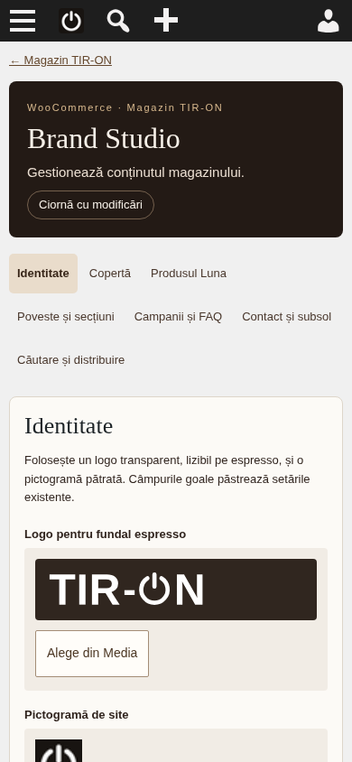
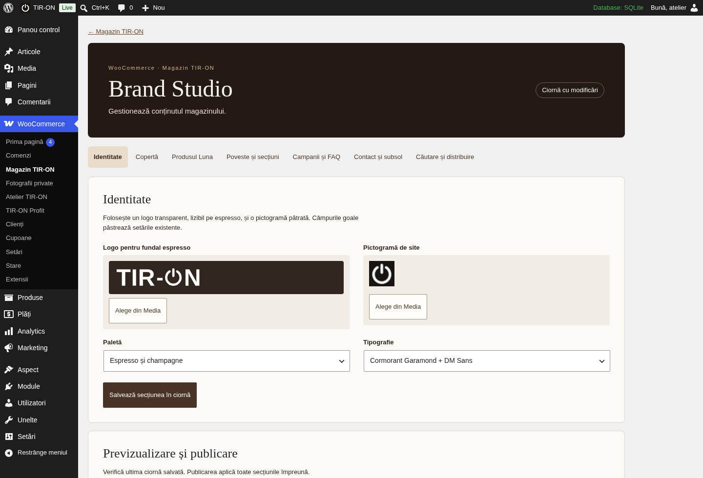

# Brand Studio V7

În WordPress, deschide **WooCommerce → Magazin TIR-ON → Brand Studio** cu un cont de administrator al magazinului. Poți pregăti o schimbare de pe telefon, o poți verifica pe pagina reală și poți alege când devine vizibilă clienților.

## Prima modificare

1. Intră în **Copertă → Titlu și introducere**. Modifică primul rând și apasă **Salvează secțiunea în ciornă**. Fiecare filă își salvează propriile câmpuri.
2. Alege **Previzualizează Acasă** sau **Previzualizează Luna**. Doar un administrator autorizat, conectat în aceeași sesiune, poate deschide ciorna. După o altă salvare, deschide previzualizarea din nou.
3. În **Previzualizare și publicare**, deschide **Modificări în așteptare**. Bifează confirmarea și apasă **Publică versiunea**. Toate secțiunile salvate intră în vigoare împreună. Dacă altă filă a salvat între timp, redeschide secțiunea înainte de a continua.

| Filă | Ce poți schimba |
|---|---|
| Identitate | Logo, pictogramă, paletă și combinație de fonturi. Folosește o siglă lizibilă pe fundal închis și o pictogramă pătrată. |
| Copertă | Titlu, introducere, cele trei cadre ale caruselului, legende, selecția și ordinea cadrelor, textul și destinația fiecărui buton. Pentru fiecare cadru alege imaginea principală, apoi opțional cadrajul mobil. |
| Produsul Luna | Prezentarea de pe homepage, fotografia editorială, galeria de până la 24 de imagini, specificațiile, imaginea și descrierea ambalajului, producția și livrarea. Prima fotografie din galerie este coperta. Săgețile schimbă ordinea. Pentru video alege MP4 sau WebM și adaugă o descriere accesibilă. Prețul și stocul rămân în editorul de produs WooCommerce. |
| Poveste și secțiuni | Imaginile și textul comparației, cei trei pași, ideile de cadouri și secțiunile vizibile pe homepage. Alege împreună fotografia de referință, relieful stins și varianta iluminată. Verifică manual același subiect și același cadraj înainte de publicare. |
| Campanii și FAQ | Anunț, interval opțional în fusul orar al magazinului și până la șase întrebări cu răspuns. Un anunț fără date rămâne afișat până îl retragi. Campania de Crăciun existentă în panoul comercial funcționează independent. |
| Contact și subsol | E-mail public, telefon, rețele sociale, text de subsol și pagini publicate pentru confidențialitate și termeni. Linkurile juridice din Studio se aplică subsolului. Paginile folosite de checkout se configurează în WooCommerce. |
| Căutare și distribuire | Titlul, descrierea și imaginea socială pentru Acasă și Luna. Completează textul alternativ al imaginii în Media. |

**Biblioteca Media este publică.** Încarcă aici numai materiale de marketing aprobate. Un fișier pus în Media poate fi accesibil prin URL încă din timpul pregătirii ciornei. Fotografiile clienților se gestionează în Atelier. Studio acceptă atașamentele publice locale cu format compatibil și verifică din nou selecția la publicare.

## Revenire

În **Istoric și resetare**, alege o versiune din ultimele 12 publicări anterioare sau **Revino în ciornă la setările de bază**. Previzualizează rezultatul și publică-l când ești mulțumit. Resetarea elimină suprascrierile Studio. Tema, setările din Personalizare, meniurile și datele WooCommerce furnizează valorile de bază.

## Actualizare directă de la V5

V7 conține componentele V6, Atelier și Profit Studio. Pentru o instalare existentă la `5127a78c54242731d367c85b64af8621f8516891` folosește direct [pachetele V7](../dist/hostico/) și [fluxul de actualizare cu aprobare și rollback](HOSTICO-UPDATES.md). Alege branch-ul `engineering/v7-brand-studio`. Înainte de aprobare, verifică pe staging și confirmă că backup-ul de fișiere și bază de date poate fi restaurat.

- **Fișiere**. Tema din ZIP ajunge în `wp-content/themes/tir-on/`. Conținutul pachetului MU ajunge în `wp-content/mu-plugins/`. Păstrează `wp-config.php`, datele magazinului, directorul privat și extensiile instalate.
- **Bază de date**. Studio citește setările existente. Prima salvare creează opțiunea WordPress `tiron_brand_studio_v1`, cu încărcare la cerere. V7 nu creează tabele. Instalatorul de catalog este destinat magazinelor noi. La actualizare intră direct în Magazin TIR-ON.
- **Rollback de cod**. Folosește backup-ul release-ului din ghid pentru a reveni la pachetele V5. V5 reia conținutul anterior și ignoră opțiunea Studio. O reinstalare V7 regăsește ultima publicare. Această revenire păstrează comenzile primite între timp.

[Verificări de upgrade și regresie](V7-TESTE.md)
